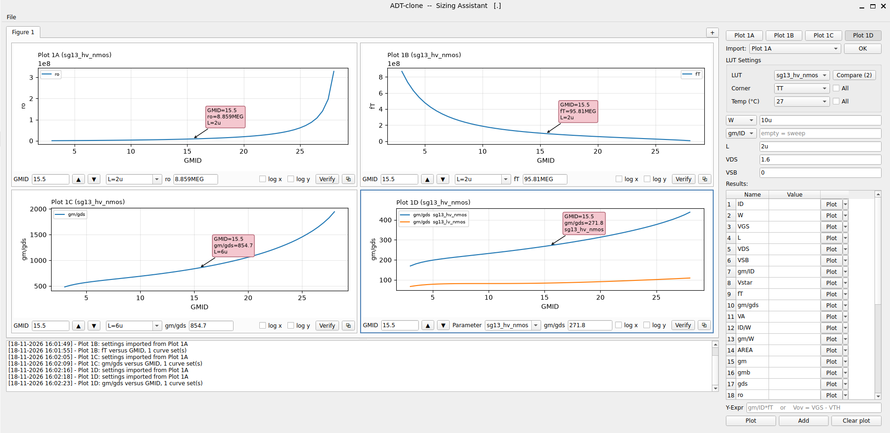

# sg13g2-gmid-toolbox

An open-source **gm/ID sizing toolbox** for the [IHP SG13G2](https://github.com/IHP-GmbH/IHP-Open-PDK)
open PDK, built on precomputed lookup tables (LUTs) extracted with
ngspice.

You give it an operating point — a current, an inversion level, a length —
and it gives you back a transistor: width, gate voltage, and every
small-signal, capacitance and noise parameter at that point. No quadratic
model, no guesswork: every number is interpolated from data the simulator
produced, and the interpolation error is *measured*, not assumed.



**You do not need ngspice, the PDK, xschem or any container to use it.**
Python and a 1.4 GB download of ready-made tables are enough.

---

## Contents

- [What it does](#what-it-does)
- [Which install is for you?](#which-install-is-for-you)
- [Quick start](#quick-start)
- [Install, step by step](#install-step-by-step) — Windows, macOS, Linux
- [Get the tables](#get-the-tables)
- [Your first design](#your-first-design)
- [Optional: Verify with ngspice](#optional-verify-with-ngspice)
- [Advanced: build your own tables](#advanced-build-your-own-tables)
- [Accuracy](#accuracy)
- [Troubleshooting](#troubleshooting)
- [Tools](#tools) · [Status and limits](#status-and-limits) · [Credits](#credits) · [License](#license)

---

## What it does

| | |
|---|---|
| devices | `sg13_lv_nmos`, `sg13_lv_pmos` (1.2 V) · `sg13_hv_nmos`, `sg13_hv_pmos` (3.3 V) |
| corners | TT, SS, FF |
| temperatures | −40, 0, 27, 85, 125 °C |
| stored per point | 33 model parameters (ID, gm, gmb, gds, all capacitances, noise, …) |
| derived | gm/ID, V\*, fT, gm/gds, VA, VDSAT, γ, fknee, Ron, … |

- **Sizing assistant** — five fields describe a transistor; fill all five
  and you get one sized device, leave one empty and it becomes a sweep.
- **Charts** — four plots per figure, any expression on any axis, linear
  or log; overlay lengths, corners and temperatures, or compare devices.
- **Cursor** — reads any point, even *between* two drawn curves; type a
  target value and it solves for the parameter that gives it.
- **Verify** — one click runs ngspice on the exact device under the
  cursor (optional, needs ngspice).
- Finger-count correction of overlap and junction capacitances,
  mismatch (Pelgrom) from the PDK's statistical models, a command-line
  engine with the same numbers as the window, CSV and PNG export.

---

## Which install is for you?

| you have | do this | you get |
|---|---|---|
| Python 3.9 or newer | [Install](#install-step-by-step) + [demo tables](#get-the-tables) | everything except the Verify button |
| Python **and** ngspice with the SG13G2 models | the above + [Verify](#optional-verify-with-ngspice) | everything |
| the [IIC-OSIC-TOOLS](https://github.com/iic-jku/IIC-OSIC-TOOLS) container | clone the repo inside it, get the tables, run | everything, Verify works out of the box |
| nothing yet | install Python first (links in each section below) | — |

**Disk space:** about 3 GB in total (2.7 GB of tables after extraction,
~200 MB of Python packages). **Memory:** any normal machine; the tables
are read from disk on demand, not loaded whole.

---

## Quick start

For readers who know their way around Python. Everyone else: the
[step-by-step section](#install-step-by-step) below has every command
for your system.

```bash
git clone https://github.com/ahmedelkali421-cpu/sg13g2-gmid-toolbox.git
cd sg13g2-gmid-toolbox
python3 -m venv .venv && source .venv/bin/activate
pip install -r requirements.txt

curl -LO https://github.com/ahmedelkali421-cpu/sg13g2-gmid-toolbox/releases/download/demo-tables-v1/gmid-demo-tables.tar.xz
mkdir tables && tar -xJf gmid-demo-tables.tar.xz -C tables

python3 gmid_gui.py tables
```

---

## Install, step by step

Pick your system. Every section ends at the same place: the toolbox
installed in a private Python environment (a *venv*) inside the
project folder, ready for the [tables](#get-the-tables).

> **Why a venv?** It keeps the toolbox's packages in the project folder
> instead of your system's Python. On recent Linux distributions it is
> not optional: `pip install` outside one is refused with
> `externally-managed-environment`.
>
> **Do not use `sudo` or a root shell** for any `pip` or `python`
> command below. Only the system packages (`apt`, `dnf`, `pacman`) need it.

<details>
<summary><b>Debian 12+, Ubuntu 23.04+, Parrot OS, Kali, Linux Mint 22+</b></summary>

```bash
sudo apt update
sudo apt install -y git python3 python3-venv python3-pip curl xz-utils

git clone https://github.com/ahmedelkali421-cpu/sg13g2-gmid-toolbox.git
cd sg13g2-gmid-toolbox
python3 -m venv .venv
source .venv/bin/activate
pip install -r requirements.txt
```

Every time you open a new terminal, go back into the folder and run
`source .venv/bin/activate` before starting the toolbox.

</details>

<details>
<summary><b>Ubuntu 22.04 and older, Debian 11</b></summary>

Same commands as above. On these versions `pip install` would also work
without the venv, but the venv is still the clean way.

```bash
sudo apt update
sudo apt install -y git python3 python3-venv python3-pip curl xz-utils
git clone https://github.com/ahmedelkali421-cpu/sg13g2-gmid-toolbox.git
cd sg13g2-gmid-toolbox
python3 -m venv .venv
source .venv/bin/activate
pip install -r requirements.txt
```

</details>

<details>
<summary><b>Fedora</b> (not yet tested — reports welcome)</summary>

```bash
sudo dnf install -y git python3 python3-pip curl xz
git clone https://github.com/ahmedelkali421-cpu/sg13g2-gmid-toolbox.git
cd sg13g2-gmid-toolbox
python3 -m venv .venv
source .venv/bin/activate
pip install -r requirements.txt
```

</details>

<details>
<summary><b>Arch, Manjaro</b> (not yet tested — reports welcome)</summary>

```bash
sudo pacman -S --needed git python python-pip curl xz
git clone https://github.com/ahmedelkali421-cpu/sg13g2-gmid-toolbox.git
cd sg13g2-gmid-toolbox
python -m venv .venv
source .venv/bin/activate
pip install -r requirements.txt
```

</details>

<details>
<summary><b>Windows 10 / 11, native</b> (not yet tested — reports welcome)</summary>

1. Install Python 3.11 or newer from [python.org](https://www.python.org/downloads/).
   On the first installer screen, tick **"Add python.exe to PATH"**.
2. Install [Git for Windows](https://git-scm.com/download/win), or skip
   it and use **Code → Download ZIP** on the GitHub page instead.
3. Open **PowerShell** and run:

```powershell
git clone https://github.com/ahmedelkali421-cpu/sg13g2-gmid-toolbox.git
cd sg13g2-gmid-toolbox
py -m venv .venv
.venv\Scripts\Activate.ps1
pip install -r requirements.txt
```

If PowerShell refuses to run `Activate.ps1` ("running scripts is
disabled on this system"), allow it once for your user and try again:

```powershell
Set-ExecutionPolicy -Scope CurrentUser RemoteSigned
```

On Windows, write `python` instead of `python3` in the commands further
down this page.

</details>

<details>
<summary><b>Windows through WSL</b> (tested)</summary>

Inside your WSL distribution (Ubuntu by default), follow the
**Debian / Ubuntu** section above. On Windows 11 the window opens on
your desktop by itself (WSLg). This is also the route to take if you
want the Verify button through the IIC-OSIC-TOOLS container.

</details>

<details>
<summary><b>macOS</b> (not yet tested — reports welcome)</summary>

With [Homebrew](https://brew.sh):

```bash
brew install python git
git clone https://github.com/ahmedelkali421-cpu/sg13g2-gmid-toolbox.git
cd sg13g2-gmid-toolbox
python3 -m venv .venv
source .venv/bin/activate
pip install -r requirements.txt
```

If `pip` cannot install PyQt5 on Apple Silicon, use Homebrew's build
instead: `brew install pyqt@5`, then create the venv with
`python3 -m venv --system-site-packages .venv` and install only the rest:
`pip install numpy matplotlib`.

</details>

---

## Get the tables

The tool reads lookup tables; it does not simulate. Two choices:

### Demo tables — 1.4 GB download, recommended to start

All four devices at the **TT corner and 27 °C**, from the
[demo-tables-v1](https://github.com/ahmedelkali421-cpu/sg13g2-gmid-toolbox/releases/tag/demo-tables-v1)
release. Every length below 2.5 × Lmin is kept and every third length
above it. Checked against the full tables at 1600 points placed between
the removed lengths: **worst error 0.11 %**, typically below 0.01 %.
Each table carries its own measured error in `meta.json` → `demo_check`.

**Linux, macOS, WSL** — inside the project folder:

```bash
curl -LO https://github.com/ahmedelkali421-cpu/sg13g2-gmid-toolbox/releases/download/demo-tables-v1/gmid-demo-tables.tar.xz
curl -LO https://github.com/ahmedelkali421-cpu/sg13g2-gmid-toolbox/releases/download/demo-tables-v1/gmid-demo-tables.tar.xz.sha256
sha256sum -c gmid-demo-tables.tar.xz.sha256          # macOS: shasum -a 256 -c ...
mkdir tables
tar -xJf gmid-demo-tables.tar.xz -C tables
```

**Windows (PowerShell)** — inside the project folder:

```powershell
curl.exe -LO https://github.com/ahmedelkali421-cpu/sg13g2-gmid-toolbox/releases/download/demo-tables-v1/gmid-demo-tables.tar.xz
Get-FileHash gmid-demo-tables.tar.xz -Algorithm SHA256
mkdir tables
tar -xJf gmid-demo-tables.tar.xz -C tables
```

Compare the hash with the one in the `.sha256` file on the release page:
`7b39c594d190d6ddc5863ec75590a50f1b2e5e7ee6e871065fa6fa32d24ed800`.
If Windows' built-in `tar` cannot open the `.tar.xz`, extract it with
[7-Zip](https://www.7-zip.org/) instead (twice: `.xz`, then `.tar`) into
a folder named `tables`.

You should end up with eight folders:

```
tables/
  lut_hv_nmos_tt_27   edge_hv_nmos_tt_27
  lut_hv_pmos_tt_27   edge_hv_pmos_tt_27
  lut_lv_nmos_tt_27   edge_lv_nmos_tt_27
  lut_lv_pmos_tt_27   edge_lv_pmos_tt_27
```

The `.tar.xz` file can be deleted once extracted.

### Full tables — every corner and temperature

60 tables, about 81 GB. Not hosted yet; you can
[build them yourself](#advanced-build-your-own-tables).

### Start the window

```bash
python3 gmid_gui.py tables
```

The argument is the folder that holds the tables. The window lists every
device, corner and temperature it finds there.

---

## Your first design

A lab-style specification: a common-source NMOS with

| spec | value |
|---|---|
| intrinsic gain gm·ro (= gm/gds) | 50 V/V (not dB) |
| gm/ID | 10 S/A |
| supply VDD | 1.8 V |
| output DC level | VDD/2 = 0.9 V → **VDS = 0.9 V** |
| bias current ID | 20 µA |

A 1.8 V supply is above the 1.2 V core devices' rating, so the device
is the 3.3 V **`sg13_hv_nmos`**.

**In the window:**

1. **LUT** → `sg13_hv_nmos`, **Corner** → TT, **Temp** → 27.
2. Fill the five fields, leaving **L empty** — L becomes the x axis:
   - size: **ID** = `20u`
   - inversion: **gm/ID** = `10`
   - L: *(empty)*
   - VDS = `0.9`, VSB = `0`
3. In the **Results** table, press **Plot** beside **gm/gds**. You get
   gm/gds against L.
4. Click anywhere on the plot to place the cursor, then type `50` in
   the y readout under the plot and press **Enter**. With a single curve
   drawn, the cursor moves along it to the length that gives 50:
   **L ≈ 543 nm**.
5. Type `543n` into the **L** field and press **Enter**. All five fields
   are filled now, so the **Results** column shows the device:
   **W ≈ 4.65 µm**, VGS ≈ 787 mV, fT ≈ 3.6 GHz, ro ≈ 250 kΩ, …

**The same from the command line:**

```bash
python3 gmid_sa.py tables/lut_hv_nmos_tt_27 --ID 20u --GMID 10 --L 543n --VDS 0.9 --VSB 0
```

**Why the current did not move L.** Change ID to `10u` or `50u` and
repeat: L stays at ≈ 543 nm and only W changes, in proportion. At a
fixed gm/ID, gm and gds both scale with W, so gm/gds — the gain — does
not depend on the current at all. That is the core of the gm/ID method:
gm/ID and L set the *character* of the device (gain, speed, noise), the
current only sets its *size*.

**The family view.** The same answer from the other direction: leave
**gm/ID** empty instead and put several lengths in L
(`0.5u, 0.6u, 0.8u, 1u`). Plot gm/gds; you get one curve per length
against gm/ID. Put the cursor at gm/ID = 10 and type `50`: the cursor
reads *between* the curves and returns the same L.

---

## Optional: Verify with ngspice

The **Verify** button re-simulates the exact device under the cursor
and shows table and simulator side by side. It is the only feature that
needs a simulator, and it needs three things:

1. **ngspice** with OSDI support (version 39 or newer),
2. the **SG13G2 ngspice models** (`libs.tech/ngspice/models` from the
   [IHP-Open-PDK](https://github.com/IHP-GmbH/IHP-Open-PDK)),
3. the **PSP103 model compiled to OSDI** and loaded by ngspice.

The simplest way to have all three is the
[IIC-OSIC-TOOLS](https://github.com/iic-jku/IIC-OSIC-TOOLS) container,
where Verify works with no configuration. Outside it, point the toolbox
at your models:

```bash
export SG13G2_MODELS=/path/to/IHP-Open-PDK/ihp-sg13g2/libs.tech/ngspice/models
```

and make sure your `~/.spiceinit` loads the compiled `psp103.osdi`. A
step-by-step native setup for Verify is not documented yet.

---

## Advanced: build your own tables

Needs ngspice and the PDK (the IIC-OSIC-TOOLS container is the easy
route). One device, one corner, one temperature takes roughly 20
minutes to a few hours depending on the device, and the raw simulator
output is large (tens of GB) until it is packed.

```bash
python3 make_sweep.py hv tt                 # writes the netlist
ngspice -b sweep_hv_mos_tt.spice            # runs the sweep
python3 pack_lut.py lut_hv_tt.raw --flavour hv
rm lut_hv_tt.raw                            # the raw is large and no longer needed
```

Flavours: `hv`, `lv`, `hv_p`, `lv_p`. Corners: `tt`, `ss`, `ff`. Add
`--temp 85` (and so on) for other temperatures. Repeat with
`make_edge.py` for the companion single-finger table that the
finger-count correction needs.

To make a demo pack out of full tables, the way the release was made:

```bash
python3 make_demo_lut.py FULL_TABLES_DIR DEMO_DIR --pack gmid-demo-tables.tar.xz
```

---

## Accuracy

Measured rather than claimed. Every table is verified against ngspice at
points that deliberately fall **between** grid nodes, where
interpolation error is largest:

| device | median residual | worst case |
|---|---|---|
| LV NMOS | 0.0001 % | 0.065 % |
| LV PMOS | 0.0000 % | 0.004 % |
| HV NMOS | 0.0004 % | 0.426 % |
| HV PMOS | 0.0002 % | 0.289 % |

The worst cases sit in the short-channel region, where the model itself
is sharpest. The tool **tells you the error at the point you are
looking at**, and the `Verify` button runs ngspice on that exact device
so you can see table vs simulator side by side.

The demo tables add at most 0.11 % on top of this (see
[Get the tables](#get-the-tables)).

---

## Troubleshooting

**`error: externally-managed-environment` when running `pip install`**
Your distribution protects its own Python. Use a venv, as in the
[install section](#install-step-by-step): `python3 -m venv .venv`,
`source .venv/bin/activate`, then `pip install -r requirements.txt`.

**`The virtual environment was not created successfully because ensurepip is not available`**
Install the venv package: `sudo apt install python3-venv`.

**`qt.qpa.plugin: Could not load the Qt platform plugin "xcb"`** (Linux)
Qt is missing some system libraries. On Debian / Ubuntu:

```bash
sudo apt install -y libxcb-xinerama0 libxcb-cursor0 libxkbcommon-x11-0 \
  libxcb-icccm4 libxcb-image0 libxcb-keysyms1 libxcb-randr0 \
  libxcb-render-util0 libxcb-shape0
```

**`ModuleNotFoundError: No module named 'numpy'` (or PyQt5)**
The venv is not active in this terminal. Go to the project folder and
run `source .venv/bin/activate` (Windows: `.venv\Scripts\Activate.ps1`).

**The window opens but lists no device**
The folder you passed does not contain the tables directly. Run
`python3 gmid_gui.py tables` where `tables` holds the eight `lut_*` and
`edge_*` folders, not a folder above it.

**Verify says ngspice is not found, or the models cannot be loaded**
See [Optional: Verify with ngspice](#optional-verify-with-ngspice).
Everything else in the tool works without it.

Anything else: please [open an issue](https://github.com/ahmedelkali421-cpu/sg13g2-gmid-toolbox/issues)
with your system, the command you ran and the full error message.

---

## The one idea to understand

A transistor's operating point is **five fields**:

| field | alternatives |
|---|---|
| size | `W` or `ID` |
| inversion level | `VGS` or `V*` or `gm/ID` |
| length | `L` |
| drain bias | `VDS` |
| body bias | `VSB` |

**Fill four and leave one empty — the empty one becomes the sweep axis.**
Fill all five and you get one sized device instead of a curve.

That single rule drives the whole tool. Leave `VGS` empty and you get
curves against VGS; leave `L` empty and you get curves against length at
a fixed current and inversion level.

## Tools

| script | what it does |
|---|---|
| `gmid_gui.py` | the window: five fields, four plots, results table, cursor |
| `gmid_sa.py` | the same engine from the command line |
| `gmid_cursor.py` | point lookup — give a chart point, get the device |
| `gmid_xplore.py` | design charts (the canonical nine-panel sheet) |
| `gmid_size.py` | size from specifications |
| `gmid_corner.py` | compare corners |
| `gmid_mm.py` | mismatch / Pelgrom |
| `make_sweep.py`, `make_edge.py`, `pack_lut.py` | table generation |
| `make_demo_lut.py` | demo pack from full tables, with its error measured |
| `make_verify.py`, `check_verify.py` | accuracy verification against ngspice |

---

## Status and limits

Working software that has been used for real sizing, but young. **Bug
reports are the most useful thing you can send** — especially install
reports from systems marked "not yet tested" above.

- SG13G2 only so far. The device definitions live in one table at the
  top of `make_sweep.py`; another PDK means adding an entry there, not
  rewriting the tool.
- Transistor level only. There is no circuit-level topology library or
  optimiser.
- The window is tested with PyQt5 on Linux (native and WSL).

## Credits

The gm/ID methodology and the lookup-table approach are not mine. This
implementation follows the published work of **Prof. Hesham Omran**
(Ain Shams University), in particular:

- H. Omran et al., *"Analog IC Design Using Precomputed Lookup Tables:
  Challenges and Solutions"*, IEEE Access, 2020.
- H. Omran, *"Toward Memory-Efficient Analog Design Using Precomputed
  Lookup Tables"*, Electronics 13(18):3776, 2024.

and the classic treatment in Jespers & Murmann, *Systematic Design of
Analog CMOS Circuits*.

This project is an **independent open-source implementation** written
from the published methodology.

Thanks to the [IHP](https://github.com/IHP-GmbH/IHP-Open-PDK) team for
the open PDK and to [IIC-OSIC-TOOLS](https://github.com/iic-jku/IIC-OSIC-TOOLS)
for the toolchain.

## License

MIT — see [LICENSE](LICENSE).
